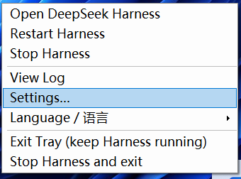

# dsh-tray-launcher

> ## 👉 Double-click **`setup.cmd`** to set it up. That's the only step.
> ## 👉 双击 **`setup.cmd`** 即可完成设置，就这一步。

> The wizard asks for your **language** and your **Harness path**, then writes `settings.json` and — if you tick it — installs logon autostart and a desktop shortcut.<br>
> 向导会问你**语言**和 **Harness 路径**，然后写入 `settings.json`；勾选了的话还会装好开机自启和桌面快捷方式。

A Windows tray icon that opens DeepSeek Harness for you, so you no longer have to type `pnpm dsh web` in a terminal.
The tray menu and the settings wizard are available in **5 languages: 简体中文 / English / 日本語 / 한국어 / Русский**.

> **Unofficial.** Not affiliated with DeepSeek. This repository contains no official code and no DeepSeek brand assets (the tray icon is drawn from scratch).
> Per the DeepSeek Harness brand guidelines the project name uses the **DSH** abbreviation; the full product name appears only in descriptive text.
> Official desktop app: [deepseek.com/download](https://www.deepseek.com/download/).

## Why this little tool

Starting DeepSeek Harness by hand means opening a terminal, going to the repository and typing `pnpm dsh web` — every single time. This replaces all of that with **one click**.



- **🖱️ One click. No terminal, no console flash.** A tray icon that starts Harness and opens the chat in your browser. Nothing to type, no Git Bash window, no black box popping up.
- **🧙 A setup wizard that does the thinking.** `setup.cmd` asks two things — language and Harness path — and handles the rest. It auto-detects your Harness checkout; a globally installed `dsh` works too, and then you leave the path empty.
- **🌏 Five languages, switched live.** Simplified Chinese, English, Japanese, Korean and Russian cover the tray menu, tooltips, notifications and the settings window. Change it and everything re-labels itself immediately.
- **⏱️ It does not slow your boot down.** At logon it only puts the tray icon up; node, tsx and the browser wait until you actually click. Prefer Harness ready and waiting? Tick "start Harness at logon".
- **🖥️ It never starts a second Harness.** Before doing anything it probes the port and reuses a Harness that is already listening — including one you started yourself in a terminal. The tray is single-instance, and "open" requests from the desktop shortcut are handed to the running tray.
- **📌 A desktop shortcut from one button.** The settings window creates `dsh-tray-launcher.lnk`; double-clicking it starts Harness (if needed) and pops the chat straight into your browser.
- **🔧 Non-destructive by design.** Autostart is an ordinary `HKCU …\Run` entry, so it shows up in **Task Manager → Startup** and can be disabled like any other app. Quitting the tray never kills your session or your running jobs.
- **🧯 No admin rights, nothing extra to install.** It runs on the Windows PowerShell 5.1 that already ships with Windows. The only prerequisite is the Harness checkout you already have.
- **📄 Logs when something looks off.** Service output goes to `harness.log` (auto-rotated at 5 MB), tray activity to `tray.log`.
- **🪶 Tiny and readable.** Two PowerShell scripts, one VBS launcher, one icon. No runtime to install, no dependencies, no build step.

## Getting started (step by step)

### Step 1 — get the files

```sh
git clone https://github.com/alexlicon-codes/dsh-tray-launcher.git
```

**No git?** Open the repository page, click the green **Code** button → **Download ZIP**, then right-click the downloaded ZIP → **Extract All…** and choose a folder such as `D:\dsh-tray-launcher`.

> ⚠️ Extract it first — double-clicking files from inside the ZIP preview window will not work.
> ⚠️ A simple path helps (for example `D:\dsh-tray-launcher`). Avoid running it from a temporary folder or from inside an archive.

### Step 2 — double-click `setup.cmd`

That is the whole setup. The wizard opens and asks three things:

1. **Language** — pick yours; every label switches immediately.
2. **Harness path** — already filled in if your Harness checkout was found. If not, click **Browse…** and select the folder containing `pnpm-workspace.yaml` and `apps\cli`. Using a global `dsh` instead? Leave it empty.
3. **Three logon options** — the defaults are fine if you are unsure:
   - ✅ **start the tray tool at logon** — the icon comes back after every reboot
   - ⬜ **start Harness at logon** — tick only if you want Harness already running
   - ✅ **start at logon and open browser** — open the chat automatically once Harness is up

Click **Save** — done. (You can also click **Create desktop shortcut** right there.)

> Prerequisite: this launcher starts *your* DeepSeek Harness. You need either an existing Harness checkout (with `pnpm-workspace.yaml` and `apps\cli`) or a global `dsh` command. No administrator rights are required.

### Step 3 — use it

- A tray icon appears near the clock. **Double-click it** to open Harness — the first start takes a few seconds while Harness boots.
- **Right-click it** any time to restart or stop Harness, view the logs, open **Settings…**, or switch language.
- The desktop shortcut does the same thing: start Harness, then pop the chat in your browser.

From here on you never type the launch command again.

## What to double-click

| I want to… | Double-click |
| --- | --- |
| **Configure it for the first time** (language / Harness path / logon options) | `setup.cmd` |
| Start the tray silently (no console window) | `start-tray.vbs` |
| Just open Harness and pop the chat in my browser | desktop shortcut `dsh-tray-launcher.lnk` |
| Turn logon autostart off | `uninstall-autostart.cmd` |

## Settings window (`setup.cmd`, or "Settings…" in the tray menu)

Both entries open the **same window**: run `setup.cmd` the first time, then right-click the tray icon → **Settings…** whenever you want to change something.

**Step 1 picks the language, step 2 picks the Harness path** (with a Browse button):

- **Language / 语言** — 简体中文 / English / 日本語 / 한국어 / Русский. The whole window re-labels itself immediately when you switch.
- **Harness path** — the repository root (the folder containing `pnpm-workspace.yaml` and `apps\cli`). Leave it **empty** if you use a globally installed `dsh`.
- **Launch command** — defaults to `pnpm dsh web --no-open` (for a global `dsh`: `dsh web --no-open`).
- **Port** — defaults to `3080`.
- **Three logon options**:
  1. **Start the tray tool at logon** — puts the tray icon up automatically when you sign in (writes the registry Run key).
  2. **Start DeepSeek Harness at logon** — also boots Harness when the tray appears (slightly slower sign-in).
  3. **Start at logon and open browser** — after option 2 starts Harness, also open the browser.
- **Create desktop shortcut (launch Harness & open chat)** — a button. Clicking it drops a `dsh-tray-launcher.lnk` on your desktop; double-clicking that later starts Harness (if it is not running) and pops the chat in your browser.

**Save** writes `settings.json` and adds or removes the registry autostart entry according to option 1. The wizard pre-fills what it can detect: if it finds a Harness checkout or a global `dsh`, the fields are filled in for you; only if it finds nothing do you need to Browse manually.

The tray icon: **double-click = open Harness**. Right-click menu:

```
Open DeepSeek Harness
Restart Harness
Stop Harness
──────────────
View Log
Settings…
Language / 语言          ▸  简体中文 ✓
                              English
                              日本語
                              한국어
                              Русский
──────────────
Exit Tray (keep Harness running)
Stop Harness and exit
```

Switching **Language / 语言** re-labels the menu, the tray tooltip and the balloon tips **immediately**, and writes the choice back to `settings.json` for next time.

## Configuration: `settings.json`

Generated on first run; just edit it if you prefer.

| Key | Default | Meaning |
| --- | --- | --- |
| `language` | `"zh"` | `zh` / `en` / `ja` / `ko` / `ru` |
| `repoRoot` | `""` | Working directory for the launch command; empty means "use a global `dsh`" (`setup.cmd` fills this in for you) |
| `port` | `3080` | Used to detect whether Harness is already running |
| `harnessCommand` | `"pnpm dsh web --no-open"` | The actual launch command. `--no-open` stops `dsh web` from opening the browser itself — that decision belongs to the tray |
| `readyTimeoutSec` | `180` | How long to wait for the service to become ready |
| `autoOpen` | `true` | "Start at logon and open browser": open the browser once Harness has auto-started |
| `startOnLaunch` | `false` | "Start DeepSeek Harness at logon": start Harness when the tray itself was launched at sign-in |
| `trayAutostart` | `false` | "Start the tray tool at logon": whether the registry Run key is installed (maintained by the settings window) |

`run-harness.cmd` is **generated** from `settings.json` (it stays double-clickable on its own); manual edits to it are overwritten — change `harnessCommand` instead.

## Behaviour

- Before starting anything it probes `127.0.0.1:<port>`: if something is **already listening it reuses it** (for example a Harness you started yourself in a terminal) and never starts a second one.
- If nothing is listening, it runs `harnessCommand` in the background with a hidden window, writes the output to `harness.log`, and opens the browser when ready if `autoOpen` is on.
- **At logon it only puts up the tray by default and does not start Harness** — the node / tsx / browser cost is deferred until you actually click. Tick "Start DeepSeek Harness at logon" in **Settings…** if you would rather have it ready right away.
- The desktop shortcut carries `--open`: **if Harness is already running it just opens the browser**; otherwise it starts Harness and opens the browser once ready. It hands the "open" request to the already-running tray through an `open.request` file, so you never end up with two Harness instances.
- Clicking "Open" while a start is already in flight does not spawn a second instance; it just records "open the browser when ready".
- A single-instance mutex means double-clicking twice never produces two tray icons.
- `harness.log` rotates to `harness.prev.log` once it passes 5 MB; `tray.log` records what the tray itself did.
- "Stop Harness" only kills the node/pnpm/dsh process listening on that port. If another program holds the port, it refuses to kill it and says so in `tray.log`.

## Menu appearance

- Every item uses **Microsoft YaHei UI 9pt** so mixed Chinese/English labels line up; the fallback chain is Microsoft YaHei → Segoe UI → the system menu font.
- The main menu disables both the icon gutter (`ShowImageMargin = false`) and the check column (`ShowCheckMargin = false`) so the labels are left-aligned; checkmarks only appear in the **Language / 语言** submenu and in the settings window.
- On startup it calls `SetProcessDPIAware()`, so at high DPI the menu text is drawn natively instead of being stretched and blurred.

## Notes

- It runs on the built-in Windows PowerShell 5.1; `start-tray.vbs` launches it with a hidden window.
- Both `.ps1` files are **UTF-8 with BOM**. Without the BOM, PowerShell 5.1 mis-decodes Chinese text — keep the BOM when editing them.
- Exiting the tray does not interrupt your session: choose "Exit Tray (keep Harness running)".
- **Logon autostart lives in the registry**, not in a Startup-folder `.lnk`: `HKCU\Software\Microsoft\Windows\CurrentVersion\Run`, value name `dsh-tray-launcher`, data `"wscript.exe" "…\start-tray.vbs" --at-logon` (the `--at-logon` flag is how the tray knows it was started at sign-in, and therefore whether `startOnLaunch` applies). Reason: on some systems `WScript.Shell` cannot save or read a `.lnk` whose path contains non-ASCII characters — it fails with `Unable to save shortcut` (measured: ASCII names work, CJK names always fail, even inside the same folder), while the registry is natively Unicode. The installer also cleans up `.lnk` files older versions left in the Startup folder so the tray is never launched twice. The entry shows up in **Task Manager → Startup** and can be disabled there as usual.
- **The desktop shortcut** is a `.lnk` (`dsh-tray-launcher.lnk`, ASCII-only name) targeting `wscript.exe "…\start-tray.vbs" --open`; regenerate it any time with the "Create desktop shortcut" button in the settings window. If it fails to be created, only the desktop icon is affected — autostart still works.
- **Keep every `.cmd` file pure ASCII and do not add `chcp`**: when cmd.exe switches code pages inside a batch file that also contains multi-byte characters, it mis-parses by byte offset (you see errors like `'cho' is not recognized as an internal or external command`). That is why console-facing text here is English and the Chinese details go into `autostart.log`.
- **Batch files must keep CRLF line endings.** cmd.exe mis-parses LF-only `.cmd` files (labels and parenthesised blocks first), and GitHub's "Download ZIP" bypasses `core.autocrlf`. `.gitattributes` therefore pins `*.cmd`, `*.bat` and `*.vbs` to `-text` so they are stored exactly as they are on disk; `.ps1` files are left on `text=auto` (PowerShell accepts either ending).

## License

[MIT](LICENSE). This is a community tool and is not affiliated with DeepSeek.

---

# dsh-tray-launcher（中文）

> ## 👉 双击 **`setup.cmd`** 即可完成设置，就这一步。
> ## 👉 Double-click **`setup.cmd`** to set it up. That's the only step.

> 向导会问你**语言**和 **Harness 路径**，然后写入 `settings.json`；勾选了的话还会装好开机自启和桌面快捷方式。<br>
> The wizard asks for your **language** and your **Harness path**, then writes `settings.json` and — if you tick it — installs logon autostart and a desktop shortcut.

常驻系统托盘，一键打开 Harness —— 不用再开终端敲 `pnpm dsh web`。
托盘菜单与设置向导支持 **5 种语言：简体中文 / English / 日本語 / 한국어 / Русский**。

> **非官方项目。** 与 DeepSeek 官方无关；仓库内不含官方代码或品牌资产（托盘图标为自制）。
> 项目名按 DeepSeek Harness 品牌规范使用 **DSH** 缩写；完整产品名仅出现在描述性文字中。
> 官方桌面端请看 [deepseek.com/download](https://www.deepseek.com/download/)。

## 这个工具好在哪

手动启动 DeepSeek Harness，意味着每次都要开终端、进仓库、敲 `pnpm dsh web`。这个工具把这一切变成**一次点击**。


- **🖱️ 一键搞定，不用终端、不闪黑框。** 托盘图标启动 Harness 并自动打开浏览器对话；不用敲命令，没有 Git Bash 窗口，也不会有黑框一闪而过。
- **🧙 向导替你想好了。** `setup.cmd` 只问两件事 —— 语言和 Harness 路径，其余全自动。它会自动找到你的 Harness 代码；用全局 `dsh` 的话路径留空即可。
- **🌏 五种语言，随切随变。** 简体中文 / English / 日本語 / 한국어 / Русский 覆盖托盘菜单、悬停提示、气泡通知和设置窗口，切换后界面立刻跟着变。
- **⏱️ 不拖慢开机。** 登录时只把托盘图标放上去，node、tsx 和浏览器都等你真正点开才启动。想一登录就绪，勾上「开机自动启动 DeepSeek Harness」即可。
- **🖥️ 绝不会启动第二份 Harness。** 动手前先探测端口，已经有人在监听就直接复用（包括你自己在终端里起的那份）。托盘是单实例的，桌面快捷方式的「打开」请求也会交给已在运行的托盘执行。
- **📌 一个按钮就有桌面快捷方式。** 设置窗口会生成 `dsh-tray-launcher.lnk`，以后双击它 = 启动 Harness（没在跑就启动）+ 直接弹出浏览器对话。
- **🔧 不侵入系统。** 开机自启就是一条普通的 `HKCU …\Run` 注册表项，会出现在**任务管理器 → 启动**里，可以像别的应用一样禁用。退出托盘不会杀掉你的会话或正在跑的任务。
- **🧯 不需要管理员权限，也不用额外装东西。** 跑在 Windows 自带的 PowerShell 5.1 上；唯一的前提就是你本来就有的那份 Harness 代码。
- **📄 出问题时有日志。** 服务输出进 `harness.log`（超过 5 MB 自动轮转），托盘自身记录在 `tray.log`。
- **🪶 体量小、代码短。** 两个 PowerShell 脚本 + 一个 VBS 启动器 + 一个图标，没有运行时依赖，也不需要构建。

## 傻瓜式安装（三步）

### 第一步 —— 把文件拿到本地

```sh
git clone https://github.com/alexlicon-codes/dsh-tray-launcher.git
```

**没装 git？** 打开仓库页面 → 点绿色的 **Code** 按钮 → **Download ZIP**，然后右键下载到的压缩包 → **全部解压缩…**，选一个像 `D:\dsh-tray-launcher` 这样的目录。

> ⚠️ 一定要先解压。直接在压缩包的预览窗口里双击文件是不行的。
> ⚠️ 路径越简单越好（比如 `D:\dsh-tray-launcher`）；不要放在临时目录里，也不要直接从压缩包里运行。

### 第二步 —— 双击 `setup.cmd`

这就是全部安装过程。向导会问你三件事：

1. **语言** —— 选你的语言，窗口上的文字立刻切换。
2. **Harness 路径** —— 如果程序探测到了你的 Harness 代码，这里已经填好了；没探测到就点「浏览…」，选择含 `pnpm-workspace.yaml` 与 `apps\cli` 的那个文件夹。用全局 `dsh` 的话留空。
3. **三个开机选项** —— 拿不准就保持默认：
   - ✅ **开机自动启动托盘工具** —— 每次开机图标都会回来
   - ⬜ **开机自动启动 DeepSeek Harness** —— 想让它开机就绪才勾
   - ✅ **开机启动 + 弹出浏览器** —— Harness 起来后自动打开对话

点**保存**即可。（也可以顺手点一下「创造桌面快捷方式」。）

> 前提：这个启动器启动的是**你自己的** DeepSeek Harness。你需要已经有一份 Harness 代码（含 `pnpm-workspace.yaml` 与 `apps\cli`），或者 PATH 上有全局 `dsh`。不需要管理员权限。

### 第三步 —— 开始用

- 时钟旁边会出现托盘图标，**双击它**就能打开 Harness；第一次启动要等几秒让 Harness 跑起来。
- **右键它**随时可以：重新启动 / 停止 Harness、查看日志、打开**设置…**、切换语言。
- 桌面快捷方式效果一样：启动 Harness，然后把对话弹到浏览器里。

从现在起，你再也不用敲那条启动命令了。

## 双击哪个文件

| 想做什么 | 双击这个 |
| --- | --- |
| **第一次配置**（语言 / Harness 路径 / 开机选项） | `setup.cmd` |
| 启动托盘（无控制台窗口，不会闪黑框） | `start-tray.vbs` |
| 只想开 Harness 并弹出浏览器对话 | 桌面「dsh-tray-launcher」快捷方式 |
| 关掉开机自启 | `uninstall-autostart.cmd` |

## 设置窗口（`setup.cmd`，或托盘菜单「设置…」）

两个入口打开的是**同一个窗口**：第一次双击 `setup.cmd`，之后随时右键托盘图标 →「设置…」。

**第一步选语言、第二步选 Harness 路径**（带「浏览…」按钮）：

- **语言 / Language**：简体中文 / English / 日本語 / 한국어 / Русский，选中后整个设置窗口即时切换。
- **Harness 路径**：仓库根目录（含 `pnpm-workspace.yaml` 与 `apps\cli` 的目录）；如果用的是全局安装的 `dsh`，可以**留空**。
- **启动命令**：默认 `pnpm dsh web --no-open`（全局 dsh 用 `dsh web --no-open`）。
- **端口**：默认 `3080`。
- **三个开机选项**：
  1. **开机自动启动托盘工具** —— 登录时自动把托盘图标放出来（写注册表 Run 键）
  2. **开机自动启动 DeepSeek Harness** —— 托盘出现时顺带把 Harness 跑起来（会略微拖慢开机）
  3. **开机启动 + 弹出浏览器** —— 上面第 2 项启动后，再自动打开浏览器
- **创造桌面快捷方式（启动 Harness 并弹出浏览器对话）**：一个按钮，点了就在桌面放一个 `dsh-tray-launcher.lnk`；以后双击它 = 启动 Harness（没在跑就启动）+ 直接弹出浏览器对话。

点「保存」写入 `settings.json`，并按第 1 项增删注册表自启项。向导打开时会自动探测：能找到仓库或全局 `dsh` 就预填好，找不到才需要手动浏览选择。

托盘图标：**双击 = 打开 Harness**；右键菜单：

```
打开 DeepSeek Harness
重新启动 Harness
停止 Harness
──────────────
查看日志
设置…
语言 / Language          ▸  简体中文 ✓
                              English
                              日本語
                              한국어
                              Русский
──────────────
退出托盘（Harness 保持运行）
停止 Harness 并退出
```

「语言 / Language」切换后菜单、托盘提示、气泡通知**立即**变成对应语言，并写回 `settings.json`，下次启动沿用。

## 配置：settings.json

首次运行自动生成，直接改就行：

| 键 | 默认 | 说明 |
| --- | --- | --- |
| `language` | `"zh"` | `zh` / `en` / `ja` / `ko` / `ru` |
| `repoRoot` | `""` | 启动命令的工作目录；留空表示用全局 `dsh`（`setup.cmd` 会自动探测并填好） |
| `port` | `3080` | 用来判断服务是否已在运行 |
| `harnessCommand` | `"pnpm dsh web --no-open"` | 实际启动命令。`--no-open` 让 `dsh web` 不要自己开浏览器，开不开交给托盘决定 |
| `readyTimeoutSec` | `180` | 等待服务就绪的上限（秒） |
| `autoOpen` | `true` | 「开机启动 + 弹出浏览器」：Harness 自动启动后是否同时打开浏览器 |
| `startOnLaunch` | `false` | 「开机自动启动 DeepSeek Harness」：托盘被登录拉起时是否顺带启动 Harness |
| `trayAutostart` | `false` | 「开机自动启动托盘工具」：是否写注册表 Run 键让托盘登录自启（由设置窗口维护） |

`run-harness.cmd` 由 `settings.json` **自动生成**（保持可单独双击运行），手改会被覆盖；要换命令改 `harnessCommand`。

## 行为

- 启动时先探测 `127.0.0.1:<port>`：**已经在监听就直接复用**（比如你自己在终端起的），不会起第二份。
- 没在跑时，后台执行 `harnessCommand`，隐藏窗口、输出进 `harness.log`，就绪后按 `autoOpen` 决定是否打开浏览器。
- **登录（开机自启）时默认只放托盘、不启动 Harness**：把 node / tsx / 浏览器的开销留到你真正点开那一刻，避免拖慢开机。想改成登录就绪，在「设置…」里勾上「开机自动启动 DeepSeek Harness」。
- 桌面快捷方式带 `--open`：**已经在跑就直接弹出浏览器**；没在跑就先启动 Harness，就绪后再弹出。它通过 `open.request` 请求文件把「打开」交给已在运行的托盘执行，因此不会出现两份 Harness。
- 启动中再点「打开」不会重复拉起第二份：只会把「就绪后打开浏览器」记下来，等这一次启动完成。
- 单实例互斥体：重复双击不会出现两个托盘图标。
- `harness.log` 超过 5 MB 自动轮转为 `harness.prev.log`；`tray.log` 是托盘自身记录。
- 「停止 Harness」只结束监听该端口的 node/pnpm/dsh 进程；端口被别的程序占用时会拒绝结束并写进 `tray.log`。

## 菜单外观

- 所有条目统一用 **Microsoft YaHei UI 9pt**（中英文混排都工整），取不到时回退 Microsoft YaHei → Segoe UI → 系统菜单字体。
- 主菜单关闭左侧图标槽（`ShowImageMargin = false`）与对勾列（`ShowCheckMargin = false`），文字左对齐；勾选项只出现在「语言 / Language」子菜单和设置窗口里。
- 启动时调用 `SetProcessDPIAware()`，高 DPI 缩放下菜单文字走原生渲染，不会被位图拉伸糊掉。

## 注意

- 运行环境是 Windows PowerShell 5.1（系统自带），`start-tray.vbs` 用隐藏窗口拉起。
- 两个 `.ps1` 是 **UTF-8 with BOM**。5.1 不带 BOM 会把中文读成乱码，改文件时请保留 BOM。
- 停止托盘不会中断会话：选「退出托盘（Harness 保持运行）」即可。
- **开机自启写在注册表**：`HKCU\Software\Microsoft\Windows\CurrentVersion\Run` 下的 `dsh-tray-launcher`，值是 `"wscript.exe" "…\start-tray.vbs" --at-logon`（`--at-logon` 让托盘知道自己是登录拉起的，从而按 `startOnLaunch` 决定是否立刻启动 Harness），不是「启动」文件夹里的 `.lnk`。原因：部分系统的 `WScript.Shell` 保存/读取**路径含中文**的 `.lnk` 会直接失败（报 `Unable to save shortcut`；实测 ASCII 名可以、中文名必失败，连同一个文件夹里的中文名也失败），而注册表是 Unicode 原生。安装时会把旧版留在「启动」文件夹里的 `.lnk` 一并清掉，避免重复拉起。这一项同样出现在**任务管理器 → 启动**里，可以照常禁用。
- **桌面快捷方式**是 `.lnk`（`dsh-tray-launcher.lnk`，纯 ASCII 名），目标为 `wscript.exe "…\start-tray.vbs" --open`；随时可以在设置窗口点「创造桌面快捷方式」重新生成。它创建失败只影响桌面图标，不影响开机自启。
- **`.cmd` 一律保持纯 ASCII，且不要写 `chcp`**：cmd.exe 在批处理里切换代码页、同时文件含多字节字符时，会按字节偏移错位解析（表现为 `'cho' is not recognized as an internal or external command`）。所以面向控制台的提示统一用英文，中文详情写进 `autostart.log`。
- **`.cmd` / `.vbs` 必须保持 CRLF 行尾**：cmd.exe 解析 LF-only 的批处理会出错（标签和括号块最先中招），而 GitHub 的「Download ZIP」不经过 `core.autocrlf` 转换。所以 `.gitattributes` 把 `*.cmd`、`*.bat`、`*.vbs` 钉为 `-text`（按磁盘上的原样存储）；`.ps1` 保持在 `text=auto`（PowerShell 两种行尾都能跑）。

## 许可

[MIT](LICENSE)。本项目为社区工具，与 DeepSeek 官方无关。
